# yara-lint

yara-lint reads YARA rule files with its own tokenizer and reports the problems that stop a rule from compiling or make it slow or noisy: a missing condition, strings that are defined but never referenced, references to strings that do not exist, duplicate string identifiers, strings shorter than four bytes, conditions that are always true, regexes with unbounded `.*`, rules that scan every file in full, missing metadata and duplicate rule names across a rule set.



**Live demo:** https://jvch0512.github.io/yara-lint/ (Synthetic data.)

Haskell (GHC boot libraries only). The demo page is rendered from the tool's `--tsv` output by `scripts/site.py` (Python 3, only needed to regenerate the page).

## Use

```bash
bin/yara-lint examples
bin/yara-lint ./rules --tsv
bin/yara-lint ./rules --fail-on high       # exit 1 on any high finding
```

Exit codes: 0 ok, 1 findings at or above `--fail-on`, 2 bad input. Output is human text by default and TSV with `--tsv` (`# N files, M findings`, then `SEVERITY<TAB>RULE<TAB>WHERE<TAB>MESSAGE`).

| Rule | Severity | What it catches |
|---|---|---|
| YAR001 | high | a rule with no condition section |
| YAR002 | high | a string defined but not referenced in the condition |
| YAR003 | high | a condition that references a string that is not defined |
| YAR004 | medium | a string shorter than four bytes, or a hex string that starts with a wildcard |
| YAR005 | medium | a condition that is only `true` or `1` |
| YAR006 | low | a rule with strings and no `filesize` bound or file header check |
| YAR007 | low | a missing `description` or `author` in meta |
| YAR008 | medium | a regex with an unbounded `.*` or `.+` |
| YAR009 | medium | the same rule name defined more than once in the scanned set |
| YAR010 | high | a string identifier defined twice in one rule |
| YAR000 | info | the file contains no rules |

See [examples](examples) and [docs/sample-output.txt](docs/sample-output.txt).

## Limits

- It does not compile rules and does not know YARA modules. Module calls such as `pe.imports(...)` are tokenized but not validated.
- Anonymous strings (`$`) are not checked for use.
- Comments are removed, string, regex and hex literals are kept. Hex jumps and alternatives are counted loosely.
- `include` directives are not followed. Pass the directory that contains all the files so duplicate names are found.

## Where it fits

Reviewing YARA rule sets before they go to an EDR or a scanner, and CI checks for a threat hunting repository.

## Tests

```bash
make test    # A Haskell test program: tokenizer, every rule on good and bad rules, one-line rules, hostile input, fuzzing and CLI exit codes
```

MIT.

## Code scanning (SARIF)

`scripts/tsv2sarif.py` converts the `--tsv` output into SARIF 2.1.0, so findings show up in GitHub code scanning:

```sh
bin/yara-lint examples --tsv | python3 scripts/tsv2sarif.py --tool yara-lint --prefix examples > results.sarif
```

Upload `results.sarif` with `github/codeql-action/upload-sarif`. Severities map to SARIF levels (critical and high to error, medium to warning, low and info to note) and to a `security-severity` score.

## Validated on real data

This tool was run on public corpora and the false positives it produced were fixed. Corpus, counts and bugs found are in [docs/validation.md](docs/validation.md).
